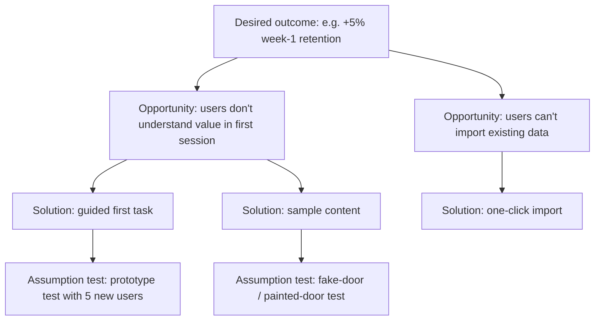
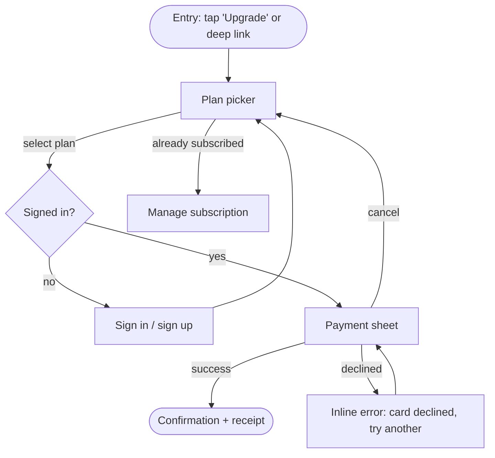

# Product Design Process Playbook

> **Use this when:** starting any design task bigger than a pixel tweak, framing a problem, choosing a process depth, or planning discovery → delivery.
> **Covers:** sizing the task, problem framing (JTBD, Opportunity Solution Trees, Shape Up, Double Diamond), flows/IA, fidelity choices, specs, handoff, stakeholder communication.
> **Skip when:** the task is a pure visual/token change with no behavior change. Use the states checklist and ship.

---

## 0. The point of view

1. **Problem before pixels.** A beautiful answer to the wrong question is waste. Spend effort framing the problem in proportion to how expensive it would be to get it wrong.
2. **Evidence has a hierarchy.** Observed behavior at scale (experiments, analytics) beats observed behavior in small samples (usability tests), which beats stated preference (interviews, surveys), which beats opinion (stakeholders, including you). Use every level. Weight them in that order.
3. **Process is a dial, not a ritual.** Running a double diamond for a padding change is theater. Shipping a new product without discovery is gambling. Match depth to risk.
4. **Smallest thing that tests the riskiest assumption.** Every artifact (sketch, prototype, test, A/B) exists to retire a specific risk. If you can't name the risk, you don't need the artifact.
5. **Users' interests are the constraint, not a variable.** You are optimizing a metric *for users*, not *against* them. If the only way a variant wins is by confusing, pressuring, or trapping people, it lost. See the heuristics and critique file for the dark-pattern veto.
6. **Design is a decision, so write the decision down.** Every non-trivial design ships with its rationale: problem, evidence, alternatives considered, trade-offs, success metric.

---

## 1. Size the task first (the process dial)

Classify every request before doing anything. Output the classification explicitly.

| Level | Example | Risk | Process | Evidence needed | Output |
|---|---|---|---|---|---|
| **L0 Tweak** | padding, color token, copy typo | ~none | Just do it; check states + a11y | None beyond the design system | Diff/redline |
| **L1 Refinement** | clearer error message, reorder fields, button hierarchy | low | Heuristic check → change → (optional) A/B | Analytics or support tickets pointing at the issue | Before/after + rationale |
| **L2 Feature** | new filter, onboarding step, settings page | medium | Frame → flows → lo-fi → test with 5 users → spec → experiment | Problem evidence + usability test | Flow, screens, spec, metric |
| **L3 Product area redesign** | redo checkout, new navigation model | high | Full discovery: research, OST, IA, multiple concepts, iterative tests, staged rollout | Qual + quant, baseline metrics, guardrails | Strategy doc, IA, prototypes, migration plan |
| **L4 New product / system** | 0→1 app, full design system | very high | Double diamond, JTBD, shaping, appetite, MVP slices | Market/job evidence, concept tests, prototypes | Vision, principles, roadmap slices |

Heuristic: **if reverting it is cheap and the blast radius is small, bias to shipping and measuring. If reverting is expensive (migrations, user retraining, brand), bias to discovery first.** This mirrors Bezos's "one-way vs two-way doors" (Amazon shareholder letter, 2015) [weak/anecdotal but useful heuristic].

---

## 2. Problem framing

### 2.1 Write the problem statement before anything else

Template (fill every slot; leave "unknown" rather than inventing):

```
WHO: [segment, with size if known]
SITUATION: [when / context where the struggle happens]
STRUGGLE: [what goes wrong; observed behavior, not your solution]
EVIDENCE: [data, quotes, tickets, funnel numbers + source + strength]
IMPACT: [on user + on business metric]
NOT SOLVING: [explicit out-of-scope]
SUCCESS LOOKS LIKE: [primary metric + guardrails + qualitative signal]
RISKIEST ASSUMPTION: [the thing that, if false, kills the idea]
```

Red flags in a framing: the "problem" contains the solution ("users need a dashboard"); no evidence line; success metric is output ("ship X") not outcome ("reduce time-to-first-value").

Two narrowing moves (Singer, *Shape Up*): ask **when** the request came up and what the person was doing, not what the feature should look like ("a calendar" became "see free spaces"); and refuse **grab-bags** — "redesign X" or "X 2.0" must be restated as one problem in one context, or split. → references/books/shape-up.md

### 2.2 Jobs to Be Done (three schools; know which you are using)

- **Christensen (jobs as progress):** people "hire" a product to make progress in a circumstance. The milkshake story is the canonical illustration (Christensen, Hall, Dillon & Duncan, *Competing Against Luck*, 2016) [moderate: rich framework, case-based evidence]. Use for: understanding *why* people switch, and who your real competitors are (often non-obvious: the milkshake competes with bananas and boredom).
- **Ulwick / Outcome-Driven Innovation (jobs as process):** decompose a job into steps and write **desired outcome statements**: *direction + metric + object + context*, e.g. "Minimize the time it takes to find a file I edited last week." Survey importance and satisfaction (1–5 or 1–10), compute **Opportunity = Importance + max(Importance − Satisfaction, 0)** (Ulwick, *What Customers Want*, 2005; *Jobs to Be Done: Theory to Practice*, 2016) [moderate: widely used commercially, limited independent validation]. Use for: prioritizing among many unmet needs in a mature product.
- **Moesta / Switch interviews (jobs as demand):** interview recent switchers about the timeline of their purchase; map the **four forces of progress**: push of the current situation, pull of the new solution, anxiety of the new, habit of the present (Moesta & Spiek; Moesta, *Demand-Side Sales 101*, 2020) [moderate]. Use for: onboarding, conversion, and switching problems. Design implication: reducing anxiety and habit often moves more than adding pull.

Job statement format the agent should output:
`When [situation], I want to [motivation], so I can [expected outcome].` (the "job story", popularized by Alan Klement / Intercom, ~2013; an early public use is Adams, "The Dribbblisation of Design", Intercom, Sept 2013, which credits Christensen's Jobs framework) [practice, not evidence].

**When NOT to use JTBD:** pure usability defects (just fix them), regulatory work, or internal tools with mandated workflows. JTBD also tends to under-weight emotional/aesthetic quality; pair with qualitative research.

### 2.3 Opportunity Solution Tree (Teresa Torres)

Structure (Torres, *Continuous Discovery Habits*, 2021) [moderate: practitioner-validated]:



Rules:
- One **outcome** at the root, owned by the team, a *product* outcome (behavior you can influence), not a business outcome (revenue) directly.
- **Opportunities** are needs/pains/desires phrased from the user's perspective, sourced from research, never solutions in disguise.
- Compare **at least three solutions** per target opportunity ("compare and contrast", not "whether or not").
- Test **assumptions**, not whole ideas. Categories: desirability, viability, feasibility, usability, ethical ("could this cause harm?"), the last one being Torres's own addition.
- Cadence: Torres recommends a weekly touchpoint with customers.

### 2.4 Shape Up (Basecamp)

From Ryan Singer, *Shape Up* (2019, free online at basecamp.com/shapeup) [moderate: one company's method, widely adopted]. Scope note: it explicitly targets only the risk of **not shipping**, not building the wrong thing (Singer defers to *Competing Against Luck*), so pair it with discovery and experiments — it is not a full process.
- **Appetite, not estimate.** Decide how much time the problem is *worth* (small batch: 1–2 weeks; big batch: 6 weeks), then shape a solution that fits. Fixed time, variable scope.
- **Shaping** produces work that is *rough* (not wireframes), *solved* (main elements figured out), and *bounded* (clear no-gos).
- Tools: **breadboarding** (places, affordances, connection lines; words only, no visuals) and **fat-marker sketches** (too coarse to bikeshed).
- **Rabbit holes and no-gos** are listed explicitly in the pitch.
- **Pitch** = problem, appetite, solution, rabbit holes, no-gos.
- **Circuit breaker:** if it doesn't ship in the cycle, it doesn't automatically get extended. Extend (≤ ~2 weeks) only when every remaining task is a must-have *and* downhill; uphill work at the deadline means reshape. Each 6-week cycle is followed by a **2-week cool-down** (bugs, exploration, betting).
- **Building:** *get one piece done* — a first vertical slice that is core, small and novel, end-to-end in week 1. Scopes are discovered from real work (end of week 1 / start of week 2), not planned upfront; a "chowder" list of loose tasks over 3–5 items means a scope is missing; prefix nice-to-haves with `~`. When cutting, compare **down to the baseline** (what customers do today), not up to the ideal.
- **Hill charts:** uphill = figuring out, downhill = executing; thirds uphill = "thought about it" / "validated the approach" / "built enough that no unknowns remain". Push the scariest unknowns uphill first.
- **Product phases:** R&D (senior spikes, no shipping expected) → production → cleanup (must-haves only, ≤ 2 cycles).

Use the breadboard notation in agent output for early flows:

```
[Invoice page]          [Payment form]            [Confirmation]
  - "Pay" button  --->    - amount field   --->      - receipt link
                          - card picker              - "back to invoices"
                          - "Submit"
```

**When NOT to use Shape Up:** heavily experiment-driven orgs where scope is set by test results; large orgs with cross-team dependencies (cycles don't sync easily).

### 2.5 Double Diamond

UK Design Council, 2005 (revised in 2019 as part of the "Framework for Innovation") [practice model, not empirical]. Discover (diverge on problem) → Define (converge on problem) → Develop (diverge on solutions) → Deliver (converge, ship). Value: forces the *first* diamond, which teams skip. Weakness: reads as linear; real work loops. Use it as a vocabulary for "are we diverging or converging right now?" and state the mode explicitly in your output.

### 2.6 How frameworks combine (default recipe)

- L4 new product: JTBD (Moesta switch interviews) → Double Diamond → Shape Up pitches for first slices.
- L3 redesign of mature area: analytics + ODI-style outcome survey → OST → concepts → staged experiments.
- L2 feature: OST branch → assumption tests → spec.
- L1: skip frameworks; one-line problem statement + metric.

---

## 3. Information architecture

Core concepts (Rosenfeld, Morville & Arango, *Information Architecture*, 4th ed., 2015) [strong as practice canon]: organization systems, labeling systems, navigation systems, search systems.

Heuristics:
- **Organize by user mental model, not org chart.** Validate with open card sort (generate) → tree test (evaluate). See the research methods selector.
- **Labels: user words, not internal jargon.** Pull vocabulary from search logs, support tickets, and interviews.
- **Breadth vs depth:** for web menus, broader and shallower structures generally outperform deep ones (Larson & Czerwinski, 1998; Zaphiris & Mtei, 1997 and later replications) [moderate]. But a broad menu with bad labels loses to a deep menu with clear labels; label quality dominates.
- **Myth: "the 3-click rule."** No evidence that users abandon after 3 clicks; Porter (UIE, 2003) found no relation between click count and success or satisfaction [moderate]. Optimize for *information scent* at each step (Pirolli & Card, information foraging theory, 1999) [strong].
- **Myth: 7±2 menu items.** Miller (1956) was about short-term memory span for recall; menus are *recognition*, so the number doesn't apply. Cowan (2001) revised working memory to ~4 chunks anyway [strong that the myth is a misapplication].
- Mobile tab bars: Apple HIG and Material both recommend 3–5 top-level tabs [platform guidance].

Output format for IA: indented tree or mermaid `graph TD`; annotate each node with the primary job it serves and its estimated traffic share if known.

---

## 4. User flows & task flows

Definitions:
- **Task flow:** single path for one task, no branching (happy path). Use to align on scope.
- **User flow:** a task flow plus decision points, errors, and entry points. Use for spec and QA.
- **Wireflow:** flow where nodes are screen thumbnails. Use for handoff on mobile.

Notation the agent should output by default: **mermaid flowchart**, with these conventions:
- Rectangles = screens/states, diamonds = decisions (system or user), rounded = start/end, parallelogram-ish `[/ /]` = external system / input.
- Every decision diamond has *all* exits labeled.
- Include at least: entry points (deep link, notification, cold start), error branches, back/cancel, and the "already done" path.



Checklist per flow: entry points listed; exit points listed; every error has a recovery path; cancel never loses user data silently; flow works for returning user mid-way (resume state).

---

## 5. Fidelity: choose the cheapest artifact that answers the question

| Question being asked | Right fidelity |
|---|---|
| "Is this the right problem / right shape?" | Words, breadboard, fat-marker sketch |
| "Does the structure / flow make sense?" | Grey-box wireframes, clickable lo-fi |
| "Can people complete the task?" | Mid-fi clickable prototype with real copy |
| "Does it feel right / trustworthy / premium?" | Hi-fi, real content, motion |
| "Does it work with real data, latency, edge cases?" | Coded prototype (React/Next.js, SwiftUI) |
| "Does it move the metric?" | Production build behind a flag, A/B test |

Notes:
- Lo-fi prototypes surface about as many usability problems as hi-fi ones in several studies (Virzi, Sokolov & Karis, 1996; Walker, Takayama & Landay, 2002) [moderate]. But lo-fi underestimates aesthetic/trust responses.
- **Real copy from the start.** Lorem ipsum hides the hardest design problems (length, tone, localization).
- **Real data in prototypes.** Long names, zero items, 10,000 items, missing avatars. Code prototypes win here; vibe-code when the risk is data/latency/interaction feel.
- Hi-fi too early → stakeholders critique color instead of structure. Show grey when you want structural feedback; say explicitly which feedback you are asking for.
- **Visual-direction ladder** (Frost, *Atomic Design*): 20-second gut test (20–30 relevant sites, 20 s each, scored 1–10; discuss the top 5, bottom 5 and most contested) → style tiles → element collage → one comp for the key template → decide the rest in the browser. → references/books/atomic-design.md

---

## 6. Design specs and PRDs

A design doc (one per L2+ feature) should contain, in this order:

1. **Summary** (3 lines: problem, solution, metric).
2. **Problem & evidence** (problem statement template from 2.1).
3. **Goals / non-goals.**
4. **Success metrics:** one primary, 2–4 guardrails (e.g. retention, support contacts, refund rate, accessibility errors), and the decision rule ("ship if primary ≥ +X% at 95% confidence and no guardrail regresses beyond −Y%").
5. **Users & jobs.**
6. **Solution:** flows (mermaid), key screens, interaction details.
7. **States matrix:** every screen × {empty, loading, partial, error, success, offline, permission-denied, first-run}. See the states checklist.
8. **Content:** final copy strings with keys, character limits, localization notes.
9. **Accessibility:** focus order, labels, contrast, dynamic type, reduced motion.
10. **Analytics:** events to log (name, trigger, properties). Agreed *before* build.
11. **Alternatives considered** and why rejected.
12. **Risks, open questions, rollout plan** (flag, % ramp, kill switch).
13. **Changelog.**

Rule: if a section is "N/A", write why. Silence reads as "forgot".

---

## 7. Handoff (design → engineering)

Handoff is a conversation, not a file drop. Principles:
- **Engineers in early**, at framing and lo-fi; feasibility surprises at handoff are a process failure.
- **Tokens, not values.** Spec `spacing.md` / `color.text.secondary`, not `16px` / `#6B7280`. If the value doesn't exist as a token, either it should be one or the design is off-system: flag it.
- **Components, not screens.** Map every element to an existing component (Code Connect / Storybook name). New components get their own spec with all variants and states.
- **Redlines only for the exceptions.** Everything on-system is implied by the system.
- **Behavior over appearance:** transitions, timing (ms + easing), what happens on rotate/resize, keyboard behavior, truncation rules, min/max content.
- **Responsive rules** as constraints ("cards fill, min 280, max 3 columns"), not just three static breakpoints.
- **Acceptance criteria** in Given/When/Then for non-obvious behavior.
- **Design QA** before release: compare build vs spec on real devices, with real data, in dark mode, at largest text size, with a screen reader.

Handoff checklist:
- [ ] All states for all screens (see checklist file)
- [ ] Copy final, keyed, with limits
- [ ] Tokens/components referenced, deviations flagged
- [ ] Interaction & motion specs
- [ ] Analytics events
- [ ] A11y annotations (focus order, labels, roles, headings)
- [ ] Edge data examples (longest, empty, RTL if relevant)
- [ ] Open questions owner + date

---

## 8. Articulating design decisions (Tom Greever)

From Greever, *Articulating Design Decisions* (2015; 2nd ed. 2020) [practitioner canon]:
- Stakeholders are users of your design process. Learn what each one cares about (revenue, risk, brand, engineering cost).
- **Listen first.** Let them finish; repeat back the concern; ask "what problem does this change solve?"
- Frame every answer around **the shared goal**, not your taste.
- Greever's three questions to prepare for any decision: *What problem does it solve? How does it affect the user? Why is it better than the alternatives?*
- Bring **evidence, not adjectives**: data > research > principles/heuristics > precedent (competitors, platform conventions) > your expertise.
- Get to **yes, and**: accept the concern, propose how to address it without wrecking the design, or propose a test that settles it.
- When you lose, lose cleanly: document the decision and its owner, set a review metric.

Stakeholder response template the agent can output:

```
Concern heard: [restate]
Goal we share: [metric/user outcome]
Why the current design: [evidence, strength-tagged]
Trade-off of the proposed change: [what gets worse]
Proposal: [compromise or test, with decision rule]
```

---

## 9. Working at scale (big products)

- **Small changes compound; so does debt.** In large products, most design work is L1/L2: incremental, measured. Treat each as an experiment with a hypothesis and decision rule.
- **Consistency is a feature.** Jakob's Law: users spend most time on *other* products, so they expect yours to work the same (Nielsen, 2000) [moderate as heuristic]. Inside a product, inconsistency taxes every user every day. Deviate only with a measured reason.
- **Local optimum trap.** A/B tests climb hills; they don't find mountains. Pair incremental testing with periodic step-change exploration (see redesign file).
- **Interaction with novelty and primacy effects:** a redesign may dip at launch (users relearning) or spike (novelty); run long enough and analyze new vs existing users separately (Kohavi, Tang & Xu, *Trustworthy Online Controlled Experiments*, 2020) [strong].

See `redesign-and-scale.md` for iterate-vs-rebuild and migration.

---

## 10. The end-to-end default loop (agent checklist)

1. Classify task level (L0–L4). State it.
2. Write the problem statement; mark unknowns.
3. Gather existing evidence (analytics, tickets, research, competitor/platform precedent). Tag strength.
4. Pick framing tool(s) for the level (Section 2.6).
5. Diverge: ≥3 meaningfully different solutions for L2+.
6. Converge with explicit criteria (user impact, metric impact, effort, risk, ethics).
7. Flow (mermaid) + states matrix.
8. Cheapest-fidelity artifact for the riskiest assumption; test it.
9. Spec + analytics + a11y.
10. Ship behind a flag; measure with pre-declared decision rule.
11. Write the learning back (what we believed, what happened, what's next).

## Anti-patterns

- **Solution-first framing** ("we need a redesign") with no problem statement.
- **Research theater**: research done after the decision to justify it.
- **One-concept presentations**: invites yes/no instead of "which and why".
- **Pixel perfection on unvalidated flows.**
- **Spec by screenshot**: no states, no behavior, no copy keys.
- **Metric-only success**: a primary metric with no guardrails invites dark patterns.
- **Process cosplay**: running every phase for every ticket.
